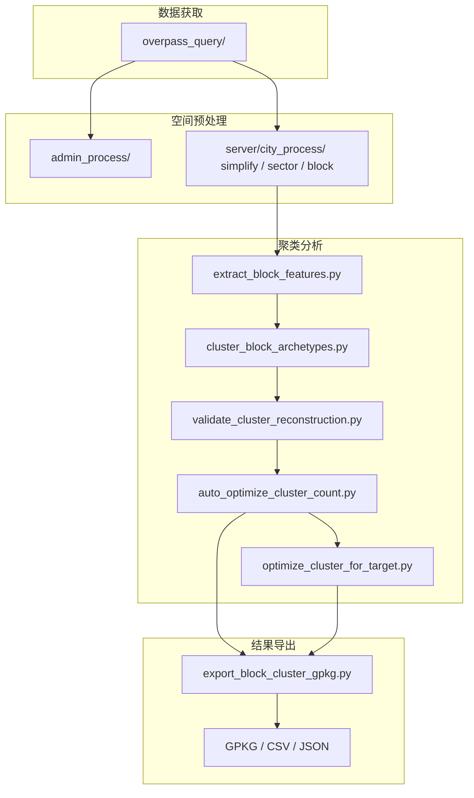

# 项目架构

## 概览

`cityarea` 不是单一算法仓库，而是一个城市空间数据处理流水线。工程从 OSM 数据抓取开始，经过行政区整理、道路和 street block 构建，再进入 block 分类与聚类分析，最终输出可用于 QGIS 或下游模拟的数据成果。聚类子系统位于这条链路的后半段，依赖前面几步产出的 block 几何和分类特征。

当前 wiki 的架构页先突出“聚类子系统”在整仓库中的位置，因为这部分脚本之间的调用关系最明确，且已经形成从特征、聚类、验证、自动调参到导出的闭环。

## 系统架构图



## 聚类子系统调用图

```mermaid
sequenceDiagram
    participant User as 用户/命令行
    participant Opt as auto_optimize_cluster_count.py
    participant Cluster as cluster_block_archetypes.py
    participant Validate as validate_cluster_reconstruction.py
    participant Export as export_block_cluster_gpkg.py

    User->>Opt: 启动参数搜索
    loop 每组参数 + 每个 seed
        Opt->>Cluster: cluster_blocks(...)
        Cluster-->>Opt: assignments / prototypes / feature matrix
        Opt->>Validate: validate_reconstruction(...)
        Validate-->>Opt: global eval / cluster eval / block eval
    end
    Opt-->>User: bestauto 结果
    User->>Export: 导出空间图层
    Export-->>User: 带 cluster_id 的 GPKG
```

## 目录分工

| 路径 | 主要职责 |
|---|---|
| `overpass_query/` | OSM 数据抓取 |
| `admin_process/` | 行政区层级、编码、归属关系整理 |
| `server/city_process/` | 城市道路、sector、street block、聚类分析 |
| `data/` | 运行时默认数据目录 |
| `docs/` | 额外专题文档与算法说明 |
| `.mini-wiki/` | wiki 配置、缓存、聚合文档 |

## 聚类系统核心职责

| 脚本 | 核心职责 | 输入 | 输出 |
|---|---|---|---|
| `extract_block_features.py` | 生成 `val_pct_*` 组成向量 | block/sector + evidence | 宽表/长表特征 |
| `cluster_block_archetypes.py` | 两阶段聚类 | 特征矩阵 | assignment / prototype |
| `validate_cluster_reconstruction.py` | centroid 重建验证 | feature matrix + assignment | global/cluster/block eval |
| `auto_optimize_cluster_count.py` | 参数网格搜索 | 聚类参数列表 | bestauto 结果 |
| `optimize_cluster_for_target.py` | 局部贪心拆分弱簇 | feature matrix + assignment | tuned assignment |
| `export_block_cluster_gpkg.py` | 回写空间图层 | block gpkg + assignment | 输出 gpkg |

## 设计特点

- 聚类不是一次性静态 KMeans，而是“聚类 + 可重建性验证 + 稳定性比较”的复合流程。
- `construction` 等值可以先从距离空间中排除，再作为解释性元数据加回。
- `auto_optimize_cluster_count.py` 把工程问题转成了可搜索的目标函数问题。
- `optimize_cluster_for_target.py` 采用局部再切分，而不是每次重跑全局聚类，成本更可控。

## 相关文档

- [index.md](/E:/C++pandan/workcode/cityarea/.mini-wiki/wiki/index.md:1)
- [getting-started.md](/E:/C++pandan/workcode/cityarea/.mini-wiki/wiki/getting-started.md:1)
- [城市聚类系统/_index.md](/E:/C++pandan/workcode/cityarea/.mini-wiki/wiki/城市聚类系统/_index.md:1)
- [docs/clustering_algorithm_parameters.md](/E:/C++pandan/workcode/cityarea/docs/clustering_algorithm_parameters.md:1)

**Section sources**
- [README.md](/E:/C++pandan/workcode/cityarea/README.md:12)
- [cluster_block_archetypes.py](/E:/C++pandan/workcode/cityarea/server/city_process/cluster_block_archetypes.py:200)
- [auto_optimize_cluster_count.py](/E:/C++pandan/workcode/cityarea/server/city_process/auto_optimize_cluster_count.py:150)
- [export_block_cluster_gpkg.py](/E:/C++pandan/workcode/cityarea/server/city_process/export_block_cluster_gpkg.py:130)
