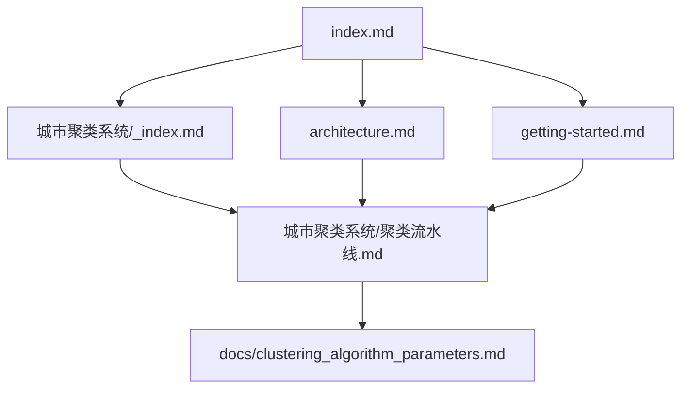

# 文档地图

## 文档关系图

## 阅读路径建议

| 读者角色 | 推荐路径 |
|---|---|
| 新开发者 | `index -> getting-started -> architecture` |
| 聚类算法维护者 | `index -> 城市聚类系统/_index -> 聚类流水线 -> clustering_algorithm_parameters.md` |
| GIS 导出维护者 | `architecture -> 聚类流水线 -> export_block_cluster_gpkg.py` |

## 当前 wiki 覆盖范围

| 范围 | 状态 |
|---|---|
| 聚类分析链路 | 已初始化 |
| 行政区处理 | 待补充 |
| 道路与 street block 生成 | 待补充 |
| OSM 抓取链路 | 待补充 |

## 相关文档

- [index.md](/E:/C++pandan/workcode/cityarea/.mini-wiki/wiki/index.md:1)
- [architecture.md](/E:/C++pandan/workcode/cityarea/.mini-wiki/wiki/architecture.md:1)
- [城市聚类系统/_index.md](/E:/C++pandan/workcode/cityarea/.mini-wiki/wiki/城市聚类系统/_index.md:1)

**Section sources**
- [README.md](/E:/C++pandan/workcode/cityarea/README.md:35)
- [docs/clustering_algorithm_parameters.md](/E:/C++pandan/workcode/cityarea/docs/clustering_algorithm_parameters.md:1)
