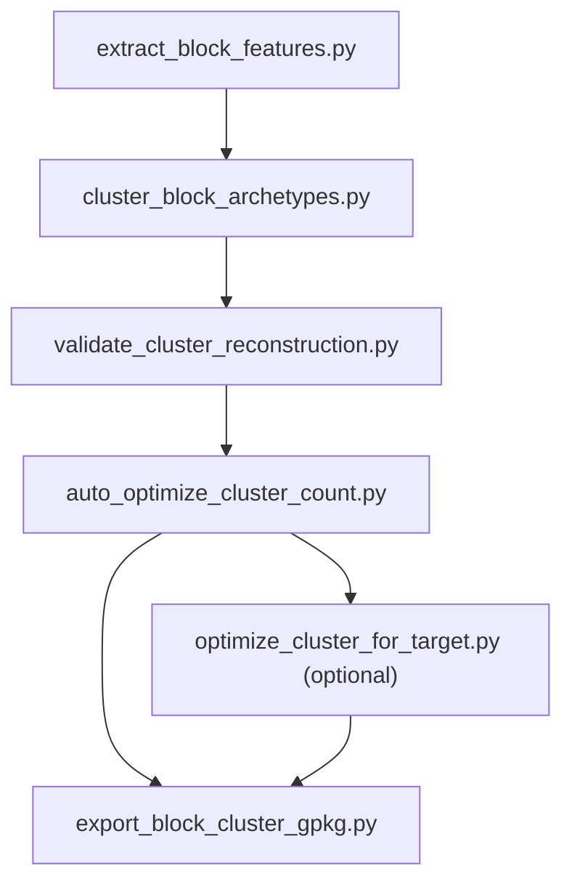

# cityarea Wiki

`cityarea` 是一个以 Python 为主的城市 GIS 处理工程，围绕 OSM 数据抓取、道路与街区构建、sector/block 生成、分类特征提取、聚类分型和空间导出展开。当前这份 wiki 先完成“聚类系统”方向的初始化配置，后续可以继续扩展到行政区、道路处理和导出链路。

从代码结构看，聚类相关逻辑集中在 `server/city_process/` 下，形成了一条相对完整的分析流水线：先把 block 转换为 `val_pct_*` 组成向量，再通过两阶段聚类生成 archetype，随后用 centroid 重建质量校验结果，最后把最优 assignment 回写到 GPKG 图层。这部分已经是项目中最适合优先文档化的核心分析链路。

## 文档导航

| 文档 | 说明 | 适合读者 |
|---|---|---|
| [architecture.md](/E:/C++pandan/workcode/cityarea/.mini-wiki/wiki/architecture.md:1) | 项目架构和聚类子系统位置 | 新加入开发者 |
| [getting-started.md](/E:/C++pandan/workcode/cityarea/.mini-wiki/wiki/getting-started.md:1) | 环境、数据目录、聚类运行顺序 | 需要跑通脚本的人 |
| [doc-map.md](/E:/C++pandan/workcode/cityarea/.mini-wiki/wiki/doc-map.md:1) | 文档关系图与阅读路径 | 想快速定位文档的人 |
| [城市聚类系统/_index.md](/E:/C++pandan/workcode/cityarea/.mini-wiki/wiki/城市聚类系统/_index.md:1) | 聚类子系统总览 | 聚类算法阅读者 |
| [城市聚类系统/聚类流水线.md](/E:/C++pandan/workcode/cityarea/.mini-wiki/wiki/城市聚类系统/聚类流水线.md:1) | 聚类流程、参数、产物和脚本职责 | 算法与工程维护者 |

## 聚类子系统预览

## 当前初始化范围

- 已建立 `.mini-wiki/` 目录结构与基础配置
- 已建立聚类系统专题文档与总导航
- 已把数学背景和参数说明保留在 [docs/clustering_algorithm_parameters.md](/E:/C++pandan/workcode/cityarea/docs/clustering_algorithm_parameters.md:1)
- 后续可继续增量补齐“道路与街区处理”“行政区处理”“OSM 抓取链路”

## 推荐阅读路径

1. 先读 [getting-started.md](/E:/C++pandan/workcode/cityarea/.mini-wiki/wiki/getting-started.md:1)，确认运行目录与依赖。
2. 再读 [architecture.md](/E:/C++pandan/workcode/cityarea/.mini-wiki/wiki/architecture.md:1)，理解聚类子系统在工程里的位置。
3. 接着读 [城市聚类系统/聚类流水线.md](/E:/C++pandan/workcode/cityarea/.mini-wiki/wiki/城市聚类系统/聚类流水线.md:1)，进入具体脚本。

**Section sources**
- [README.md](/E:/C++pandan/workcode/cityarea/README.md:1)
- [cluster_block_archetypes.py](/E:/C++pandan/workcode/cityarea/server/city_process/cluster_block_archetypes.py:289)
- [auto_optimize_cluster_count.py](/E:/C++pandan/workcode/cityarea/server/city_process/auto_optimize_cluster_count.py:102)
- [docs/clustering_algorithm_parameters.md](/E:/C++pandan/workcode/cityarea/docs/clustering_algorithm_parameters.md:1)
