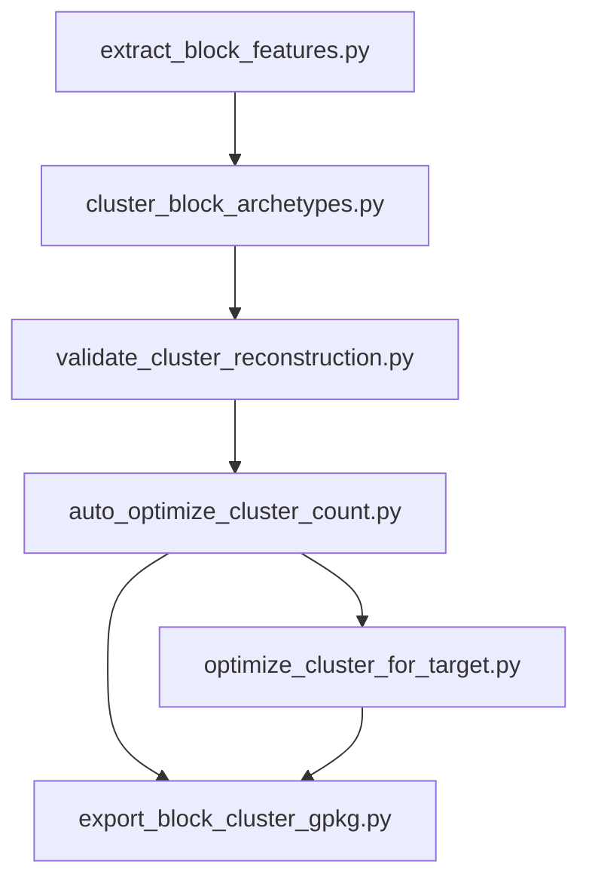

# 城市聚类系统

本专题聚焦 `server/city_process/` 下的 block 聚类相关脚本。该子系统的目标不是单纯给每个 block 一个簇标签，而是建立一套“组成向量 -> archetype -> 重建验证 -> 自动调参 -> 空间回写”的完整分析闭环。

在工程层面，这套系统之所以重要，是因为它把 GIS 面数据和可解释聚类连接起来：前端是空间几何和分类占比，后端是以 `val_pct_*` 为核心的向量表示，中间通过 centroid 原型把“类”解释成可重建、可导出、可比较的 archetype。

## 子系统结构

## 文档列表

| 文档 | 内容 |
|---|---|
| [聚类流水线.md](/E:/C++pandan/workcode/cityarea/.mini-wiki/wiki/城市聚类系统/聚类流水线.md:1) | 聚类脚本职责、调用顺序、输入输出、参数入口 |
| [docs/clustering_algorithm_parameters.md](/E:/C++pandan/workcode/cityarea/docs/clustering_algorithm_parameters.md:1) | 数学公式、参数作用、传递链路、调参建议 |

## 阅读建议

- 如果你先关心“这几个脚本先跑谁、后跑谁”，先读 [聚类流水线.md](/E:/C++pandan/workcode/cityarea/.mini-wiki/wiki/城市聚类系统/聚类流水线.md:1)。
- 如果你更关心“silhouette、ARI、cosine、top-k overlap 怎么参与评分”，直接读 [docs/clustering_algorithm_parameters.md](/E:/C++pandan/workcode/cityarea/docs/clustering_algorithm_parameters.md:1)。

**Section sources**
- [cluster_block_archetypes.py](/E:/C++pandan/workcode/cityarea/server/city_process/cluster_block_archetypes.py:289)
- [validate_cluster_reconstruction.py](/E:/C++pandan/workcode/cityarea/server/city_process/validate_cluster_reconstruction.py:50)
- [auto_optimize_cluster_count.py](/E:/C++pandan/workcode/cityarea/server/city_process/auto_optimize_cluster_count.py:102)
