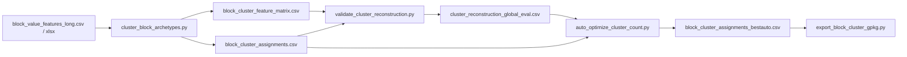

# 聚类流水线

## 概览

聚类链路围绕 5 个主要脚本展开：

| 脚本 | 作用 | 主要产物 |
|---|---|---|
| `cluster_block_archetypes.py` | 两阶段聚类 | `block_cluster_assignments.csv` |
| `validate_cluster_reconstruction.py` | centroid 重建验证 | `cluster_reconstruction_global_eval.csv` |
| `auto_optimize_cluster_count.py` | 参数搜索与稳定性比较 | `*_bestauto.csv` |
| `optimize_cluster_for_target.py` | 对弱 cluster 局部再拆分 | `*_tuned.csv` |
| `export_block_cluster_gpkg.py` | 空间回写导出 | block cluster gpkg |

## 数据流

## 调用顺序

### 1. 初始聚类

`cluster_block_archetypes.py` 做两阶段聚类：

- 先按 dominant value 家族做 macro bucket
- 再在每个 bucket 内做 silhouette 选 k + 局部 KMeans

### 2. 聚类验证

`validate_cluster_reconstruction.py` 用每个 cluster 的 centroid 反推 block：

- 计算 `MAE`
- 计算 `RMSE`
- 计算 `cosine_similarity`
- 计算 `topk_overlap`

### 3. 自动调参

`auto_optimize_cluster_count.py` 做两层循环：

- 外层枚举参数组合
- 内层枚举随机 seed

然后：

- 调 `cluster_blocks(...)`
- 调 `validate_reconstruction(...)`
- 汇总 trial score
- 计算 seed 间 ARI 稳定性
- 保存全局最优 `bestauto`

### 4. 局部再优化

`optimize_cluster_for_target.py` 不重跑全局聚类，而是：

- 找最弱 cluster
- 在这个 cluster 内部再做一次局部 KMeans
- 把差类拆开
- 直到达到目标好块率或预算耗尽

### 5. 导出空间图层

`export_block_cluster_gpkg.py` 负责把 `_block_id -> cluster_id` 再挂回 block 几何。

## 关键文件契约

### `_block_id`

整个聚类链路最重要的主键就是 `_block_id`。

它要求：

- 特征提取阶段如何生成
- 导出阶段就必须如何重建

否则 assignment 和几何会错位。

### `block_cluster_feature_matrix.csv`

这是聚类与验证共同依赖的“标准特征矩阵”：

- 聚类脚本输出
- 验证脚本输入
- 局部调优脚本输入

## 参数入口位置

| 参数类型 | 脚本入口 |
|---|---|
| 聚类结构参数 | `cluster_block_archetypes.py` |
| 验证指标参数 | `validate_cluster_reconstruction.py` |
| 搜索列表参数 | `auto_optimize_cluster_count.py` |
| 贪心局部调优参数 | `optimize_cluster_for_target.py` |
| 导出图层参数 | `export_block_cluster_gpkg.py` |

详细数学和参数解释见：

- [docs/clustering_algorithm_parameters.md](/E:/C++pandan/workcode/cityarea/docs/clustering_algorithm_parameters.md:1)

## 相关文档

- [index.md](/E:/C++pandan/workcode/cityarea/.mini-wiki/wiki/index.md:1)
- [architecture.md](/E:/C++pandan/workcode/cityarea/.mini-wiki/wiki/architecture.md:1)
- [城市聚类系统/_index.md](/E:/C++pandan/workcode/cityarea/.mini-wiki/wiki/城市聚类系统/_index.md:1)

**Section sources**
- [cluster_block_archetypes.py](/E:/C++pandan/workcode/cityarea/server/city_process/cluster_block_archetypes.py:200)
- [validate_cluster_reconstruction.py](/E:/C++pandan/workcode/cityarea/server/city_process/validate_cluster_reconstruction.py:50)
- [auto_optimize_cluster_count.py](/E:/C++pandan/workcode/cityarea/server/city_process/auto_optimize_cluster_count.py:102)
- [optimize_cluster_for_target.py](/E:/C++pandan/workcode/cityarea/server/city_process/optimize_cluster_for_target.py:108)
- [export_block_cluster_gpkg.py](/E:/C++pandan/workcode/cityarea/server/city_process/export_block_cluster_gpkg.py:130)
