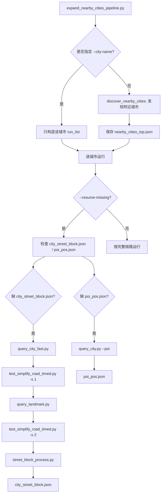

# CityArea 城市查询与补跑流程说明

本文档总结本轮在 `cityarea` 城市查询链路中完成的工作、当前推荐运行方式、文件产物关系，以及常见问题排查。目标是让“从 Beijing 发现附近城市，到每个城市生成 `city_street_block.json` 和 `poi_pos.json`”可以稳定运行，并支持只补缺失结果。

## 本轮完成的主要任务

1. 增加城市批量流程入口：`expand_nearby_cities_pipeline.py`
   - 支持从中心城市发现附近城市。
   - 支持单独指定城市运行。
   - 支持 `--resume-missing`，已有完整产物的城市不重跑，只补缺文件。

2. 保持原查询流程兼容
   - 没有要求原来的手动单步流程依赖 `expand`。
   - `query_city.py`、`query_landmark.py`、`test_simplify_road.py`、`street_block_process.py` 仍可单独运行。

3. POI 链路补齐
   - `query_city.py --poi` 会查询 POI，并调用 `pos_convert.process_poi()` 与 `pos_convert.poi_pos_convert()`。
   - 最终输出 `poi_pos.json`，供场景中 Select Actor 使用。

4. Landmark 空数据兼容
   - 当前很多城市没有手填 landmark。
   - pipeline 会创建空的 landmark 中间文件，保证后续 street block 链路可继续跑。
   - 未来如果填入 `landmarks.json`，仍可走原 landmark 流程。

5. `extend_major_road_leaf()` 几何特例修复
   - Weinan 等城市可能出现 `intersection()` 返回空几何或 `GeometryCollection`。
   - 原逻辑只处理 `LineString / MultiLineString / Point / MultiPoint`，导致 `intersect_point` 未赋值。
   - 修复位置在 `test_simplify_road.py`，不是 `test_simplify_road_timed.py`。

6. Nearby discovery 避免误触发 `osmium`
   - `expand_nearby_cities_pipeline.py` 的城市发现阶段按文件路径加载 `query_nearby_cities.py`，避免触发 `overpass_query/__init__.py` 的重型导入。
   - 这样 discovery 只需要 Overpass JSON 查询，不需要 `osmium`。
   - 真正转换 OSM 到 GPKG 的步骤仍由 `.venv` 中的 `query_city_fast.py` 使用 `osmium`。

## 当前推荐运行命令

从 Beijing 附近发现 10 个城市，并只补缺失结果：

```bash
cd /home/pixel/geo_tools
python city_process/expand_nearby_cities_pipeline.py Beijing --count 10 --resume-missing --log
```

如果中心城市 Beijing 本身也要参与检查和补跑：

```bash
cd /home/pixel/geo_tools
python city_process/expand_nearby_cities_pipeline.py Beijing --count 10 --include-center --resume-missing --log
```

只跑一个明确城市，例如 Tianjin：

```bash
cd /home/pixel/geo_tools
python city_process/expand_nearby_cities_pipeline.py Beijing --city-name Tianjin --resume-missing --log
```

其中 `Beijing --city-name Tianjin` 不表示“以 Beijing 为中心再筛 Tianjin”，而是表示跳过附近城市发现，只跑 `Tianjin`。第一个位置参数此时只是 parser 需要的中心城市参数，可保留默认或写 Beijing。

## 产物完整性判断

`--resume-missing` 目前检查两个最终产物：

| 文件 | 作用 | 缺失时动作 |
| --- | --- | --- |
| `data/city/<City>/city_street_block.json` | 城市街区与建筑基线 JSON | 补跑道路简化、landmark、street block |
| `data/city/<City>/poi_pos.json` | POI actor 位置 JSON | 只补跑 `query_city.py --poi` |

如果两个文件都存在且非空：

```text
Skip city=<City>: city_street_block.json and poi_pos.json already exist
```

这就是 `count 8` 已跑过后，再跑 `count 10` 不从头重跑旧 8 个城市的关键。

## Pipeline 执行链路



## 每一步做什么

### 1. 城市发现

入口：

```python
discover_and_save_nearby_cities(args)
```

作用：

- 使用 Overpass 查询中心城市附近的行政边界 relation。
- 默认候选城市级别为 `admin_level=5`。
- 中心城市锚点默认允许 `4|5`，避免 Beijing 这种直辖市在 `admin_level=5` 查不到。
- 输出：

```text
data/city/Beijing/nearby_cities_top10.json
```

注意：为了避免 `overpass_query/__init__.py` 触发 `osm_util -> osmium`，`expand` 中对 nearby discovery 使用文件路径加载。

### 2. 道路查询

入口：

```bash
city_process/query_city_fast.py -c <City> -r 25000
```

作用：

- 从本地 Overpass 查询道路和基础节点。
- 查询道路类型包含：

```text
motorway, trunk, primary, secondary, tertiary, road,
unclassified, track, residential, path
```

输出：

```text
data/city/<City>/city.osm
data/city/<City>/city.gpkg
```

### 3. 第一次道路简化

入口：

```bash
city_process/test_simplify_road_timed.py <City> -s 1 -t 50.0
```

说明：

- `test_simplify_road_timed.py` 是计时包装。
- 真正逻辑来自 `test_simplify_road.py`。
- `-s 1` 表示生成无 landmark 的道路、街区基础中间结果。
- `-t 50.0` 是道路简化 tolerance。

关键中间产物包括：

```text
city_road_no_leaf.gpkg
city_road_filled.gpkg
city_street_block.gpkg
```

### 4. POI 查询与转换

入口：

```bash
city_process/query_city.py -c <City> -r 25000 --poi
```

内部链路：

```python
query_city.query_cities_poi(...)
pos_convert.process_poi(...)
pos_convert.poi_pos_convert(...)
```

输出：

```text
data/city/<City>/poi.gpkg
data/city/<City>/poi_processed.gpkg
data/city/<City>/poi_point.gpkg
data/city/<City>/poi_pos.json
```

### 5. Landmark 查询与空 landmark 兼容

入口：

```bash
city_process/query_landmark.py -c <City> -f landmarks.json
```

如果当前城市没有 landmark，pipeline 会保证以下文件存在：

```text
landmarks.json
landmark_list.json
landmark_info.json
landmarks/landmarks.gpkg
landmark_polygons.gpkg
```

这样即使 `landmarks.json` 是 `{}`，后续步骤也不会因为缺中间文件直接断掉。

### 6. 第二次道路简化

入口：

```bash
city_process/test_simplify_road_timed.py <City> -s 2 -t 50.0
```

作用：

- 把 landmark 影响合并到道路和街区中。
- 输出 street block 需要的最终道路文件：

```text
city_road_w_landmark_degree2.gpkg
```

### 7. Street block JSON 生成

入口：

```bash
city_process/street_block_process.py <City>
```

输出：

```text
data/city/<City>/city_street_block.json
data/city/<City>/city_road.json
```

其中 `city_street_block.json` 是场景里 `Load City Map` 使用的核心文件。

## 常见问题与对应修复点

### `ModuleNotFoundError: No module named 'osmium'`

如果栈出现在：

```text
overpass_query/__init__.py
query_roads.py
osm_util.py
import osmium
```

说明是在 nearby discovery 阶段误触发了 package `__init__` 或 `osm_util`。

当前修复点：

```text
city_process/expand_nearby_cities_pipeline.py
```

`expand` 使用文件路径加载 `query_nearby_cities.py`，并注入轻量 `osm_util` stub，避免 discovery 依赖 `osmium`。

如果栈出现在：

```text
query_city_fast.py
overpass_query/osm_util.py
import osmium
```

则说明真正道路转换阶段需要 `.venv` 里的 `osmium`。确认子命令使用：

```text
/home/pixel/geo_tools/.venv/bin/python
```

### `UnboundLocalError: intersect_point referenced before assignment`

栈通常是：

```text
test_simplify_road_timed.py
extend_major_road_leaf
test_simplify_road.py
ops.split(row_geom, intersect_point)
```

原因：

- `row_geom.intersection(outer_ring)` 返回了空几何或 `GeometryCollection`。
- 原代码没有给 `intersect_point` 赋值。

修复点：

```text
city_process/test_simplify_road.py
```

不是 `test_simplify_road_timed.py`。`timed` 只负责计时，真正几何逻辑在 `test_simplify_road.py`。

### `poi_pos.json` 缺失

只需要补跑：

```bash
python city_process/query_city.py -c <City> -r 25000 --poi
```

或者使用：

```bash
python city_process/expand_nearby_cities_pipeline.py Beijing --city-name <City> --resume-missing --log
```

如果 `city_street_block.json` 已存在，`--resume-missing` 会只补 POI。

## 文件同步建议

服务器实际运行路径通常是：

```text
/home/pixel/geo_tools
```

本地关键文件和服务器对应关系：

| 本地文件 | 服务器文件 |
| --- | --- |
| `server/server_query_ori/city_process/expand_nearby_cities_pipeline.py` | `/home/pixel/geo_tools/city_process/expand_nearby_cities_pipeline.py` |
| `server/server_query_ori/city_process/test_simplify_road.py` | `/home/pixel/geo_tools/city_process/test_simplify_road.py` |
| `server/server_query_ori/city_process/query_city.py` | `/home/pixel/geo_tools/city_process/query_city.py` |
| `server/server_query_ori/city_process/pos_convert.py` | `/home/pixel/geo_tools/city_process/pos_convert.py` |
| `server/server_query_ori/city_process/street_block_process.py` | `/home/pixel/geo_tools/city_process/street_block_process.py` |

同步时优先只同步当前问题对应文件，避免把服务器原有可运行流程一次性污染。

## 推荐排查顺序

1. 先看报错栈的第一处项目代码文件。
2. 如果是 `expand_nearby_cities_pipeline.py` discovery import，优先检查 nearby discovery 加载方式。
3. 如果是 `query_city_fast.py`，优先检查 `.venv` 和 `osmium`。
4. 如果是 `test_simplify_road_timed.py`，继续往下看实际函数，通常要改 `test_simplify_road.py`。
5. 如果是 `street_block_process.py`，检查上游是否生成了：

```text
city_road_w_landmark_degree2.gpkg
city_building_base_line.gpkg
city_block_out_landmark.gpkg
```

## 当前最小稳定运行命令

推荐先用补缺模式：

```bash
cd /home/pixel/geo_tools
python city_process/expand_nearby_cities_pipeline.py Beijing --count 10 --resume-missing --log
```

若要并行处理城市，可在确认单城市稳定后再加：

```bash
--workers 2
```

不建议一开始开太多 worker，因为 `query_city_fast`、`simplify` 和 GDAL/GeoPandas 都较重，多个城市同时跑容易争抢 CPU、内存和磁盘 IO。

## 相关源码

- `server/server_query_ori/city_process/expand_nearby_cities_pipeline.py`
- `server/server_query_ori/city_process/query_city.py`
- `server/server_query_ori/city_process/pos_convert.py`
- `server/server_query_ori/city_process/test_simplify_road.py`
- `server/server_query_ori/city_process/test_simplify_road_timed.py`
- `server/server_query_ori/city_process/street_block_process.py`
- `server/server_query_ori/overpass_query/query_nearby_cities.py`

